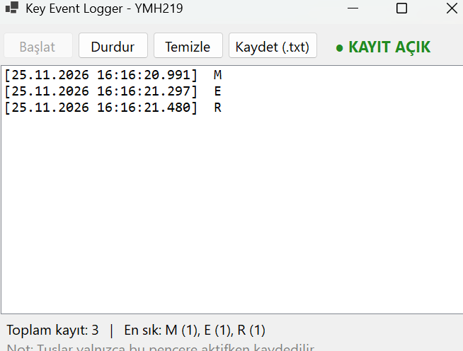
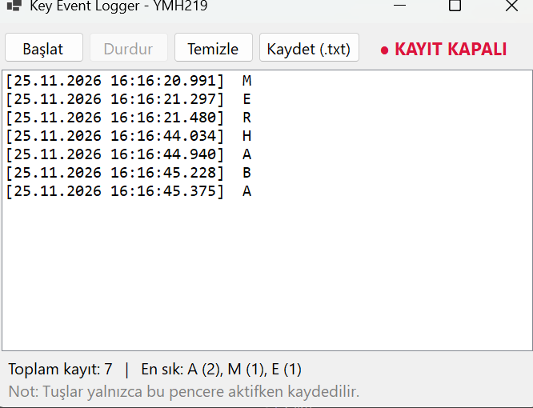

# YMH219 - Key Event Logger (Eğitsel)

Nesne Tabanlı Programlama (YMH 219) dersi kapsamında C# ve Windows Forms ile geliştirilmiş, klavye olaylarının nasıl yakalandığını ve işlendiğini gösteren eğitsel bir uygulamadır. Uygulama **yalnızca kendi penceresi aktifken** basılan tuşların adını ve zamanını listeler, istenirse kayıtları bir `.txt` dosyasına kaydeder.

## Geliştirici
- **Ad Soyad:** Hatice Kırmızıgül
- **Öğrenci No:** 250541102

## Kullanılan Teknolojiler
- C#
- .NET 10 (Windows Forms)
- `StreamWriter` ile dosya işlemleri
- LINQ (istatistik hesaplama)
- Visual Studio
- Harici NuGet paketi kullanılmamıştır.

## Kurulum ve Çalıştırma
1. Depoyu klonlayın:
   `git clone https://github.com/Hatice711/YMH219-KeyEventLogger.git`
2. `KeyEventLogger.slnx` dosyasını Visual Studio ile açın.
3. **F5** tuşuna basarak projeyi derleyip çalıştırın.

> Gereksinim: Windows işletim sistemi ve .NET 10 SDK.

## Kullanım
1. **Başlat** düğmesine basın; sağ üstteki gösterge **KAYIT AÇIK** olur.
2. Uygulama penceresi aktifken basılan tuşlar, zaman bilgisiyle listede görünür.
3. **Durdur** ile kaydı durdurun, **Temizle** ile listeyi silin.
4. **Kaydet (.txt)** ile kayıtları bir metin dosyasına kaydedin.

## Özellikler
- Tuş adı ve milisaniye hassasiyetinde zaman bilgisiyle kayıt (`[25.11.2026 15:58:01.123]  A`)
- Tuş kombinasyonlarının okunabilir gösterimi (`Ctrl + Shift + S`)
- Basılı tutulan tuşun tek kayıt olarak sayılması (KeyDown + KeyUp birlikte kullanılır)
- Başlat / Durdur / Temizle işlemleri ve duruma göre aktif-pasif olan düğmeler
- Renkli kayıt durumu göstergesi (KAYIT AÇIK / KAYIT KAPALI)
- Kayıtların `.txt` dosyasına kaydedilmesi (SaveFileDialog + StreamWriter)
- Dosya hatalarında uygulamanın kapanmadan kullanıcıya bilgi vermesi
- Toplam tuş sayısı ve en sık basılan 3 tuşun istatistiği

## Sınıf Yapısı
| Sınıf | Görevi |
|---|---|
| `KeyLogEntry` | Tek bir tuş kaydı: zaman ve tuş adı |
| `KeyLogger` | Kayıt durumu, kayıt listesi, tuş adlarının biçimlendirilmesi ve istatistikler |
| `LogFileService` | Kayıtların `StreamWriter` ile metin dosyasına yazılması |
| `Form1` | Arayüz, klavye olayları (KeyDown/KeyUp/Deactivate) ve düğme işlemleri |

## Kapsam ve Güvenlik Sınırı
Bu uygulama gerçek bir sistem keylogger'ı **değildir**:
- Tuşlar yalnızca uygulamanın kendi penceresi odaktayken, formun `KeyDown`/`KeyUp` olaylarıyla yakalanır.
- Global keyboard hook, arka planda/gizli çalışma, başlangıçta otomatik çalışma yoktur.
- Başka uygulamalardan veri toplanmaz, kayıtlar ağ üzerinden gönderilmez.
- Kayıtlar yalnızca kullanıcı **Kaydet** dediğinde, kullanıcının seçtiği konuma yazılır.

## Ekran Görüntüleri
### Kayıt Sırasında

### Kayıt Durdurulduktan Sonra

## Bilinen Sınırlamalar / Geliştirme Notları
- Odak bir kontroldeyken **Tab** tuşu Windows tarafından kontroller arası geçiş için kullanıldığından kaydedilmez.
- Kayıtlar yalnızca bellekte tutulur; dosyaya kaydedilmeden uygulama kapatılırsa kaybolur.
- Kayıtları tarih/saat aralığına göre filtreleme özelliği henüz eklenmemiştir.
